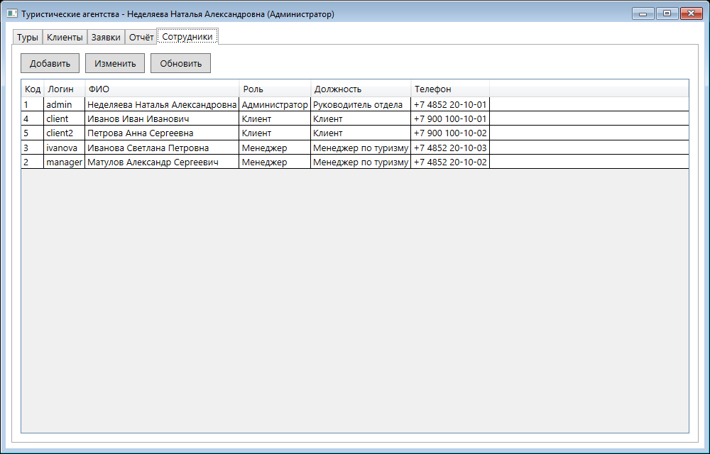
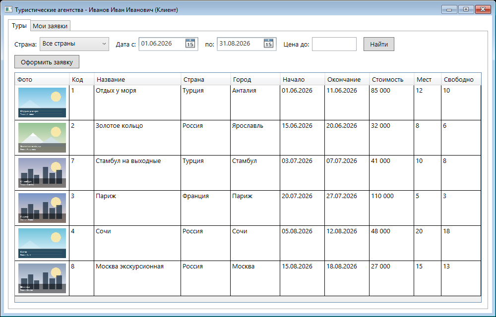

# Информационно-справочная система «Туристические агентства»

Курсовой проект по МДК 05.02 «Разработка кода информационных систем».

**Студент:** Матулов Александр, группа ИС1-45  
**Учебное заведение:** Ярославский градостроительный колледж  
**Руководитель:** Васильченко М.О.  
**Год:** 2026

WPF-приложение для автоматизации работы туристического агентства: туры, клиенты, заявки, отчёты и сотрудники. Дополнительно реализован HTTP API на ASP.NET Core.

<p align="center">
  
  <br>
  <a href="https://github.com/CoBa-3325/05.02">github.com/CoBa-3325/05.02</a>
</p>

## Содержание

- [Возможности](#возможности)
- [Роли](#роли)
- [Технологии](#технологии)
- [Структура репозитория](#структура-репозитория)
- [Подготовка базы данных](#подготовка-базы-данных)
- [Настройка подключения](#настройка-подключения)
- [Сборка и запуск](#сборка-и-запуск)
- [Демо-доступы](#демо-доступы)
- [HTTP API](#http-api)
- [Скриншоты](#скриншоты)
- [Автор](#автор)

## Возможности

- Просмотр каталога туров с фильтрацией по стране, датам и максимальной стоимости.
- Карточка тура: фотография, страна, город, даты, стоимость и количество свободных мест.
- Ведение клиентов.
- Оформление заявок с автоматическим расчётом стоимости.
- Проверка свободных мест перед созданием заявки.
- Проверка дублей заявок.
- Статусы заявок: «Новая», «Подтверждена», «Оплачена», «Отменена».
- Оплата заявки клиентом.
- Отчёт за выбранный период: количество заявок и сумма по турам.
- Разграничение прав по ролям.
- Управление сотрудниками (только администратор).
- Выбор фотографии тура из файла или из готового набора изображений.
- Выход из учётной записи.

## Роли

| Роль | Возможности |
|---|---|
| Клиент | Просмотр туров, своих заявок и их оплата |
| Менеджер | Туры, клиенты, заявки, отчёты |
| Администратор | Всё, что доступно менеджеру, плюс управление сотрудниками |

## Технологии

| Компонент | Технология |
|---|---|
| Клиентское приложение | C#, .NET Framework 4.7.2, WPF, XAML |
| HTTP API | C#, ASP.NET Core Minimal API, .NET 10 |
| База данных | Microsoft SQL Server |
| Доступ к данным | ADO.NET (`System.Data.SqlClient`, `Microsoft.Data.SqlClient`) |
| Проектирование | Figma, ER-диаграмма, блок-схема |

## Структура репозитория

```text
.
├── TourAgency/          # WPF-приложение
│   ├── Images/          # изображения туров
│   ├── *.xaml           # разметка окон
│   └── *.xaml.cs        # логика приложения
├── TourAgency.Api/      # HTTP API
│   ├── Program.cs
│   ├── appsettings.json
│   └── Properties/
├── db/                  # SQL-скрипты
│   ├── 01_tables.sql    # создание таблиц
│   └── 02_seed.sql      # тестовые данные
├── screens/             # скриншоты интерфейса
├── docs/                # QR-код репозитория
├── TourAgency.sln       # решение Visual Studio
└── README.md
```

## Подготовка базы данных

1. Подключитесь к серверу `stud-mssql.sttec.yar.ru,38325` (для доступа к серверу колледжа может потребоваться VPN).
2. Откройте базу `user87_db` в SQL Server Management Studio.
3. Выполните скрипт `db/01_tables.sql` — он создаёт таблицы:
   - `KURS_Strana` — страны;
   - `KURS_Gorod` — города;
   - `KURS_Tur` — туры;
   - `KURS_Klient` — клиенты;
   - `KURS_Sotrudnik` — сотрудники;
   - `KURS_Status` — статусы заявок;
   - `KURS_Zayavka` — заявки.
4. Выполните скрипт `db/02_seed.sql` — он заполняет таблицы тестовыми данными и создаёт демо-учётные записи.

> Скрипты создают таблицы заново, поэтому при повторном запуске существующие таблицы `KURS_*` будут удалены.

## Настройка подключения

Строка подключения к SQL Server задаётся в двух местах:

| Компонент | Файл | Параметр |
|---|---|---|
| WPF-приложение | `TourAgency/MainWindow.xaml.cs` | поле `ConnectionString` |
| HTTP API | `TourAgency.Api/appsettings.json` | `ConnectionStrings:Default` |

Пример строки подключения:

```text
Server=stud-mssql.sttec.yar.ru,38325;Database=user87_db;User Id=user87_db;Password=user87;
```

Для API дополнительно указываются параметры:

```text
Encrypt=False;TrustServerCertificate=True;
```

> В репозитории указана строка подключения к учебной базе колледжа. При необходимости замените сервер, базу, логин и пароль на свои.

## Сборка и запуск

### Требования

- Windows 10/11;
- Visual Studio 2022 (или новее) с рабочей нагрузкой «.NET desktop development»;
- .NET 10 SDK;
- .NET Framework 4.7.2;
- доступ к SQL Server.

### Сборка

```bash
dotnet build TourAgency.sln
```

### Запуск WPF-приложения

1. Откройте `TourAgency.sln` в Visual Studio.
2. Выберите проект `TourAgency` как запускаемый.
3. Нажмите `F5`.

После сборки приложение также можно запустить из командной строки:

```bash
TourAgency\bin\Debug\net472\TourAgency.exe
```

### Запуск HTTP API

```bash
dotnet run --project TourAgency.Api
```

API будет доступен по адресу `http://localhost:5259`.

WPF-приложение и API используют одну и ту же базу данных.

## Демо-доступы

Пароль для всех учётных записей — `12345`.

| Логин | Роль |
|---|---|
| `manager` | Менеджер |
| `admin` | Администратор |
| `ivanova` | Менеджер |
| `client` | Клиент |
| `client2` | Клиент |

## HTTP API

| Метод | Путь | Описание |
|---|---|---|
| `GET` | `/api/tours` | Список туров. Параметры: `country`, `dateFrom`, `dateTo`, `maxPrice` |
| `GET` | `/api/tours/{id}` | Тур по идентификатору |
| `POST` | `/api/requests` | Создание заявки |
| `GET` | `/api/requests/{id}/status` | Статус заявки |

Примеры запросов:

```bash
# Список туров
curl "http://localhost:5259/api/tours"

# Фильтр по стране и максимальной стоимости
# (кириллицу при необходимости закодируйте через URL-encoding)
curl "http://localhost:5259/api/tours?country=Турция&maxPrice=90000"

# Тур по идентификатору
curl "http://localhost:5259/api/tours/1"

# Создание заявки
curl -X POST "http://localhost:5259/api/requests" -H "Content-Type: application/json" -d "{\"klientId\":1,\"turId\":1,\"sotrudnikId\":2}"

# Статус заявки
curl "http://localhost:5259/api/requests/1/status"
```

Тело запроса на создание заявки:

```json
{
  "klientId": 1,
  "turId": 1,
  "sotrudnikId": 2
}
```

Ответ при успешном создании:

```json
{
  "id": 16,
  "status": "Новая"
}
```

## Скриншоты

<p align="center">
  
  
</p>
<p align="center">
  
  
</p>
<p align="center">
  
  
</p>

## Автор

**Матулов Александр Сергеевич**  
Группа ИС1-45, Ярославский градостроительный колледж, 2026.

Руководитель: **Васильченко М.О.**

Проект выполнен в учебных целях.
