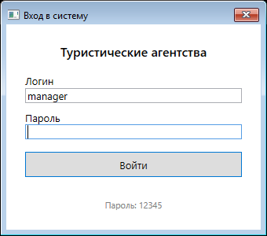
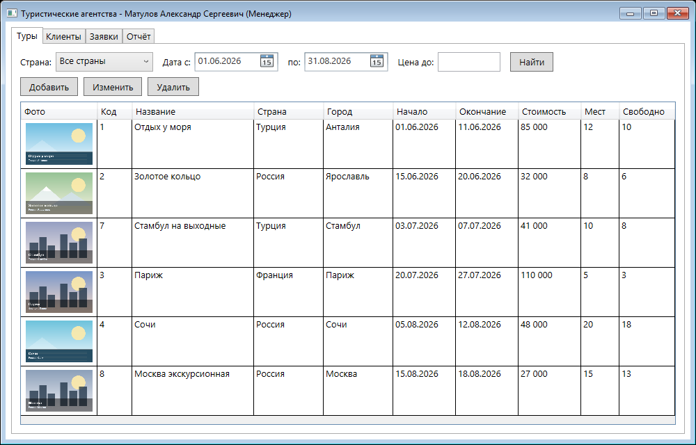
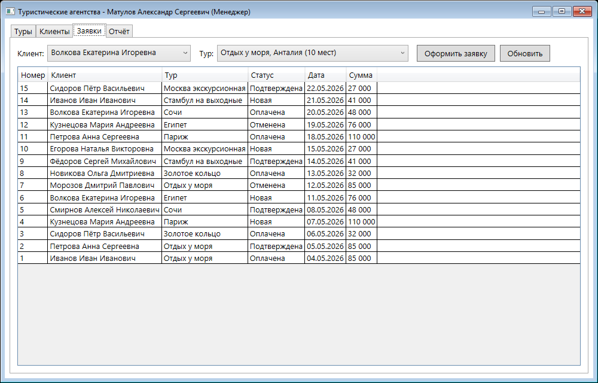
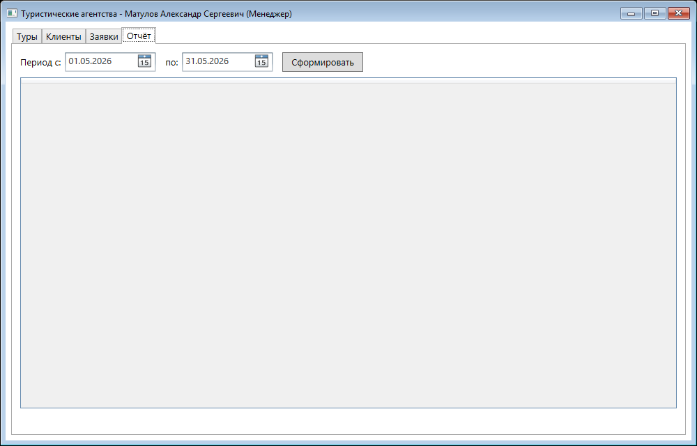

# Туристические агентства

Курсовой проект по МДК 05.02 «Разработка кода информационных систем».

**Автор:** Матулов Александр, группа ИС1-45  
**Учебное заведение:** Ярославский градостроительный колледж  
**Руководитель:** Васильченко М.О.  
**Год:** 2026

WPF-приложение для туристического агентства: туры, клиенты, заявки и отчёты.  
Есть база данных MS SQL Server и небольшой HTTP API.

<p align="center">
  
  <br>
  <a href="https://github.com/CoBa-3325/05.02">github.com/CoBa-3325/05.02</a>
</p>

## Что умеет

- просмотр туров с фильтрами по стране, датам и цене;
- добавление, изменение и удаление туров;
- ведение клиентов;
- оформление заявок и проверка свободных мест;
- защита от повторной заявки на тот же тур в тот же день;
- статусы заявок: новая, подтверждена, оплачена, отменена;
- оплата заявки клиентом;
- отчёт о продажах за период;
- роли: клиент, менеджер, администратор;
- управление сотрудниками для администратора;
- API для туров и заявок.

## Роли

| Роль | Что может |
|---|---|
| Клиент | Смотрит туры, оформляет и оплачивает свои заявки |
| Менеджер | Туры, клиенты, заявки, отчёты |
| Администратор | Всё как менеджер + сотрудники |

## Технологии

- C#, .NET Framework 4.7.2, WPF;
- MS SQL Server;
- ASP.NET Core Minimal API (.NET 10) — дополнительно.

## Что нужно

- Windows 10/11;
- .NET Framework 4.7.2;
- .NET 10 SDK — для API;
- доступ к SQL Server.

## Запуск

1. Подключитесь к учебному серверу `stud-mssql.sttec.yar.ru,38325` (может понадобиться VPN).
2. Откройте базу `user87_db`.
3. Выполните `db/01_tables.sql`, затем `db/02_seed.sql`.
4. Соберите решение:

   ```bash
   dotnet build TourAgency.sln
   ```

5. Запустите `TourAgency\bin\Debug\net472\TourAgency.exe`  
   или откройте `TourAgency.sln` в Visual Studio, выберите проект `TourAgency` и нажмите F5.

> Скрипты удаляют старые таблицы `KURS_*` и создают их заново.

Строка подключения уже прописана в `TourAgency/MainWindow.xaml.cs`.  
Для API она лежит в `TourAgency.Api/appsettings.json`.

## Демо-доступы

Пароль у всех — `12345`.

| Логин | Роль |
|---|---|
| `manager` | Менеджер |
| `admin` | Администратор |
| `ivanova` | Менеджер |
| `client` | Клиент |
| `client2` | Клиент |

## API

Запуск:

```bash
dotnet run --project TourAgency.Api
```

Адрес: `http://localhost:5259`.

| Метод | Путь | Что делает |
|---|---|---|
| GET | `/api/tours` | Список туров |
| GET | `/api/tours/{id}` | Один тур |
| POST | `/api/requests` | Создать заявку |
| GET | `/api/requests/{id}/status` | Статус заявки |

## Скриншоты

<p align="center">
  
  
</p>
<p align="center">
  
  
</p>

## Структура

```text
TourAgency/       — WPF-приложение
TourAgency.Api/   — HTTP API
db/               — SQL-скрипты
screens/          — скриншоты
docs/             — QR-код
```

Проект выполнен в учебных целях.
